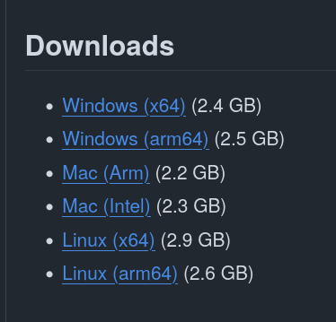

## Download WPILib 2027 Alpha 7

[Open the WPILib 2027.0.0-alpha-7 release](https://github.com/wpilibsuite/allwpilib/releases/tag/v2027.0.0-alpha-7). In its **Downloads** section, click the link that matches your computer, as shown below. Choose x64 or Arm64 for your processor; on macOS, choose **Mac (Arm)** for Apple silicon or **Mac (Intel)** for an Intel Mac.

[](https://github.com/wpilibsuite/allwpilib/releases/tag/v2027.0.0-alpha-7)

These installation instructions reference the [official WPILib installation guide](https://docs.wpilib.org/en/latest/docs/zero-to-robot/step-2/wpilib-setup.html). This is a pre-release, so check that guide for current requirements and release notes before installing.

!!! warning "This installer is for your computer"
    The Windows `.iso` is a disk image containing the WPILib computer installer. Do **not** write it to an SD card with Raspberry Pi Imager. Use the separate VMX-Pi image from [VMX-Pi Setup](vmx-pi-setup.md) when preparing the robot's storage device.

## Install on Windows

1. Download the Windows `.iso` file for your processor from the release page above.
2. In File Explorer, right-click the `.iso` and select **Mount**. If Mount is unavailable, extract the ISO with a tool such as 7-Zip.
3. Open the mounted drive or extracted folder and run `WPILibInstaller.exe`.
4. In the installer, select **Start**, then choose **Everything** for the full development setup (WPILib tools, VS Code, extensions, Java, and dependencies).
5. Choose **Install for this User** unless you need WPILib available to every account on the computer.
6. Select **Download for this computer only** for the VS Code step, then select **Next** and wait for installation to finish.
7. Select **Finish**. Open the separate **WPILib VS Code 2027** installation when working on robot code.

If Windows shows a “Windows protected your PC” message, select **More info**, then **Run anyway** to continue with the installer downloaded from the official release page.

## Install on macOS

1. Download the `.dmg` file matching your Mac (Apple silicon or Intel).
2. Open the downloaded disk image and launch `WPILibInstaller`.
3. Follow the installer. When it finishes, eject the WPILib installer disk image.

## Install on Linux

1. Download the Linux `.tar.gz` file matching your computer (x64 or Arm64).
2. Open a terminal in the folder containing the download and extract it. For x64, run:

   ```bash
   tar -xf WPILib_Linux-x64-2027.0.0-alpha-7.tar.gz
   cd WPILib_Linux-2027.0.0-alpha-7
   ./WPILibInstaller
   ```

   For Arm64, use `WPILib_Linux-Arm64-2027.0.0-alpha-7.tar.gz` and its matching extracted folder instead.
3. Follow the installer and select **Download for this computer only** when prompted for VS Code.

## Before deploying to a robot

Installing WPILib on your computer does not install the VMX-Pi operating-system image. Prepare the robot separately using [VMX-Pi Setup](vmx-pi-setup.md), then follow [Adding W4Studica Libraries](adding-w4studica-libraries.md).

WPILib Alpha 7 is a pre-release and includes breaking changes. The official release notes list Systemcore Image 14 and FIRST Driver Station Alpha 7 as requirements for the official Systemcore setup. Check the W4Studica guides for the VMX-Pi workflow and compatible robot image before deploying.
