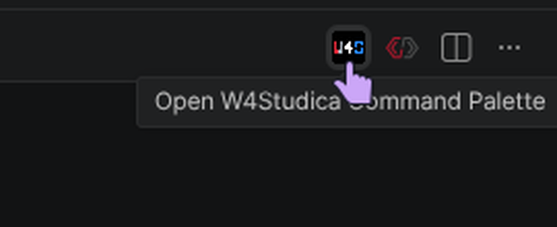
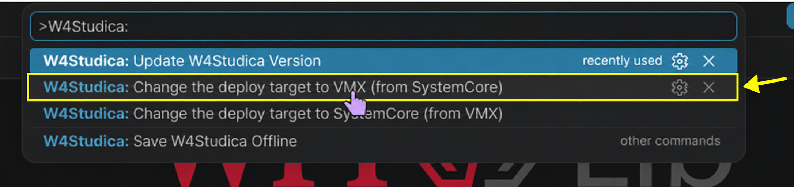

## Create a C++ robot project

Click a screenshot to view it at full size.

1. Open the Command Palette with **Ctrl+Shift+P** and run **WPILib: Create a new project**.

    

2. Set **Template** to **C++**.

3. Select **Command v2 Robot**.

4. Enter your team's assigned number in **Team Number**. Check that it matches your team before continuing.

5. Complete the remaining project fields and select **Create Project**.

    After the project opens, run a build and confirm that it succeeds. The screenshot shows **BUILD SUCCESSFUL**.

    

6. With the project open, click the **W4Studica** icon in the editor toolbar to open its Command Palette. The screenshot shows the pointer on the W4Studica icon; the tooltip reads “Open W4Studica Command Palette.”

    

7. Select **W4Studica: Change the deploy target to VMX (from SystemCore)**. The yellow outline and arrow in the screenshot mark this VMX target command.

    

## Optional: Update W4Studica library versions

With a project open, **W4Studica: Update W4Studica Version** downloads and pins the newest compatible W4Studica library versions for that project. This is a separate, optional maintenance command; it does not switch the deploy target.

## Configure W4Studica libraries

Selecting **W4Studica: Change the deploy target to VMX (from SystemCore)** in the project setup above connects the compatible prebuilt WPILib and GradleRIO releases and adds VMX build and deploy support. You do not need to add dependency blocks or copy library files into `build.gradle` by hand. Keep the project open in WPILib VS Code when using W4Studica commands.

For C++ headers and robot code examples, continue to [Start Robot Coding](start-robot-coding.md).

## Fetch the VMX SDK

The VMX HAL headers and library belong to Studica and are not part of the W4Studica download. The first time, with the VMX-Pi connected, run **deploy** (the SDK is fetched before the build) or run `./gradlew fetchVmxSdksystemcore` in the project terminal. Afterwards the project keeps its own copy, and `build` works without the robot, even after `clean`.

## Optional: Prepare for offline use

To cache the project's dependencies for later offline builds, connect the development computer to the Internet and run **W4Studica: Save W4Studica Offline** from the W4Studica command palette. The SDK from the previous step must already have been fetched.

Run the offline preparation command again after changing the deploy target, updating W4Studica versions, or adding dependencies or vendor libraries.

If something goes wrong, see [Troubleshooting](troubleshooting.md).
