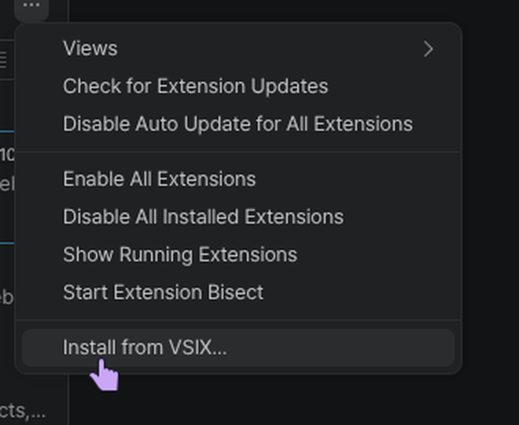

## Install the W4Studica extension

Click a screenshot to view it at full size.

1. Open the [W4Studica VS Code Extension releases](https://github.com/W4Studica/W4Studica-VS-Code-Extension/releases) and download the latest `.vsix` file from the release **Assets**.

    

2. In WPILib VS Code, click the **Extensions** icon in the Activity Bar. The screenshot shows the pointer on that icon.

    

3. Select **…** in the Extensions view, then choose **Install from VSIX…**.

    

4. Select the `.vsix` file you downloaded and click **Install**.

    

Continue to [Adding W4Studica Libraries](adding-w4studica-libraries.md) to create a C++ robot project and configure it for VMX-Pi.
