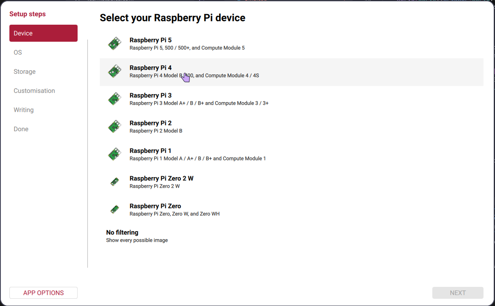
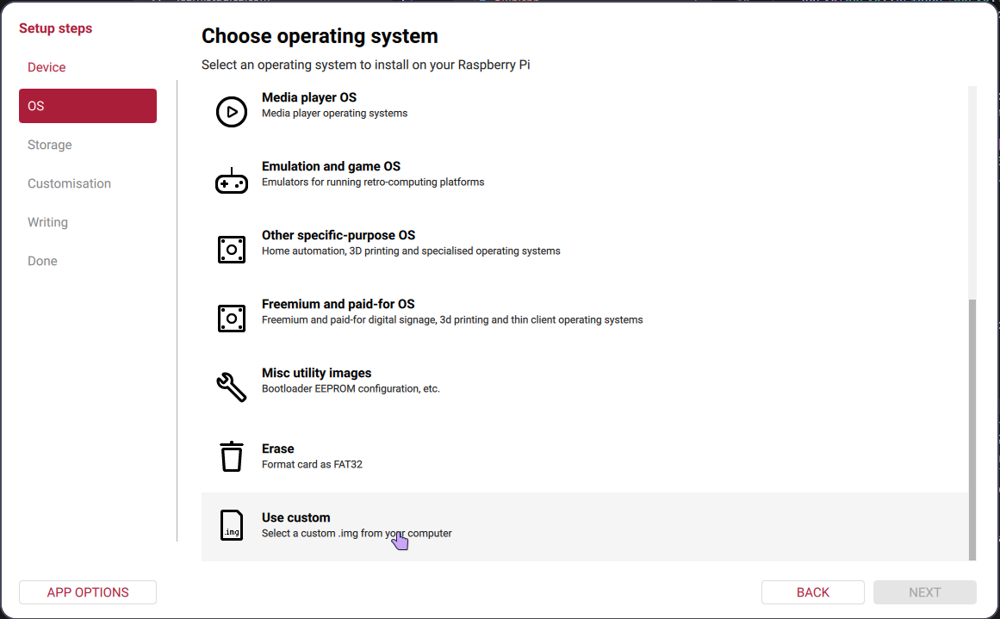
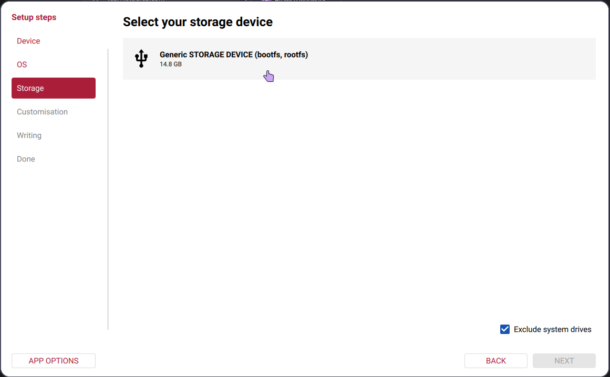
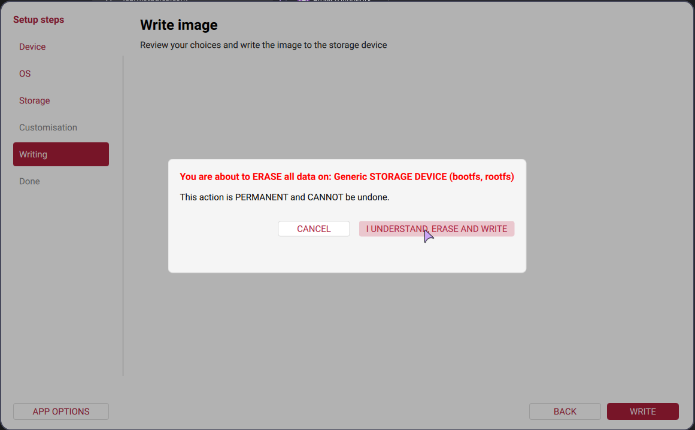
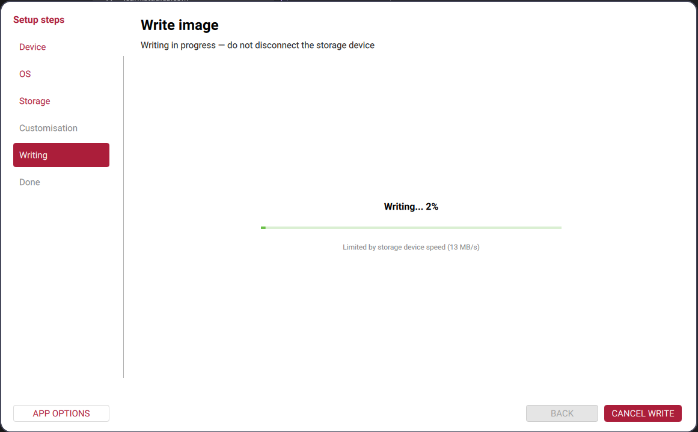
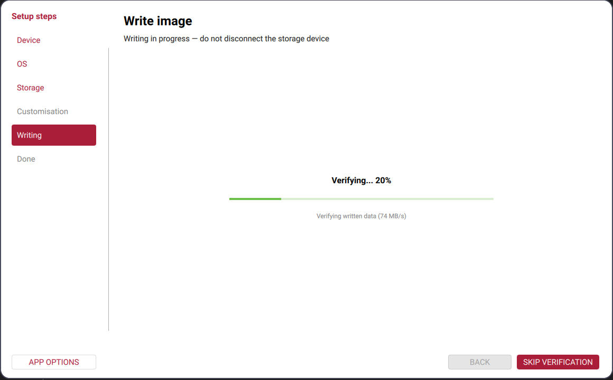

## VMX-Pi 이미지 다운로드

아래 링크에서 VMX-Pi 이미지를 다운로드하세요. 임시 링크이므로 주소가 변경될 수 있습니다.

[VMX-Pi 이미지 다운로드](https://naver.me/GuCcHhMS)

## 저장 장치에 이미지 기록하기

Raspberry Pi Imager를 사용해 다운로드한 이미지를 SD 카드 또는 사용할 저장 장치에 기록합니다. 아래 스크린샷은 Raspberry Pi 4와 14.8 GB 저장 장치로 진행한 예시입니다. 실제 환경에서는 장치 이름, 용량, 이미지 파일명이 다를 수 있습니다.

1. 사용 중인 하드웨어와 같은 Raspberry Pi 모델을 선택합니다. 아래 예시는 Raspberry Pi 4입니다.

   

2. 운영체제 목록을 열고 **Use custom**을 선택합니다.

   

3. 위 링크에서 다운로드한 VMX-Pi 이미지 파일을 선택합니다. `WPILib 2027.iso`는 PC용 WPILib 설치 파일이므로 선택하지 마세요. PC에 WPILib을 설치하려면 [소프트웨어 설치](software-install.md)을 참고하세요.

4. 이미지를 기록할 SD 카드 또는 저장 장치를 선택합니다. 다음 단계로 넘어가기 전에 장치 이름과 용량을 확인하세요.

   

5. 선택한 장치를 확인한 뒤 기록을 진행합니다. **이미지를 기록하면 선택한 장치의 모든 데이터가 삭제되며 되돌릴 수 없습니다.** 진행하기 전에 올바른 장치를 선택했는지 꼭 확인하세요.

   

6. 이미지 기록이 끝날 때까지 기다립니다. 작업 중에는 저장 장치를 연결된 상태로 두세요.

   

7. 기록이 끝난 뒤 검증도 완료될 때까지 기다립니다. 기록 또는 검증 중에는 장치를 분리하지 마세요.

   

8. **Write complete**가 표시되면 저장 장치를 사용할 수 있습니다. 장치가 자동으로 꺼내졌다면 안전하게 분리하면 됩니다.

## 로그인 정보

다음은 VMX-Pi에 고정된 로그인 정보입니다. VMX-Pi 시스템에 로그인할 때마다 이 정보를 사용하세요.

| 사용자 이름 | 비밀번호 |
|---|---|
| `ubuntu` | `password` |
